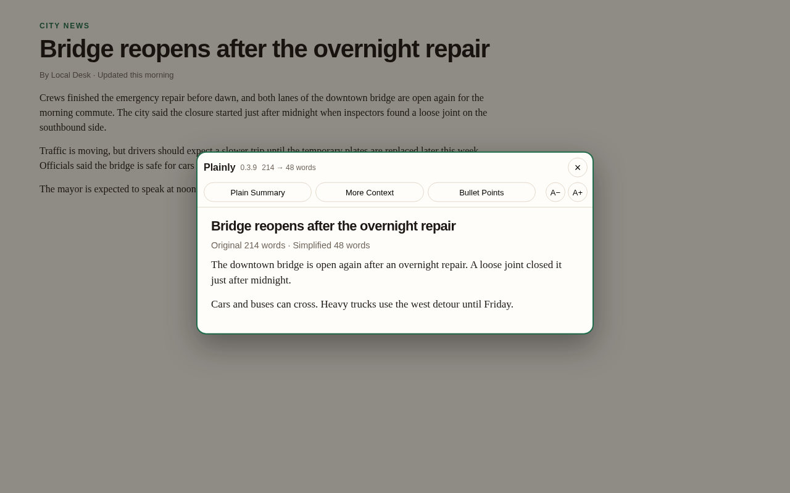
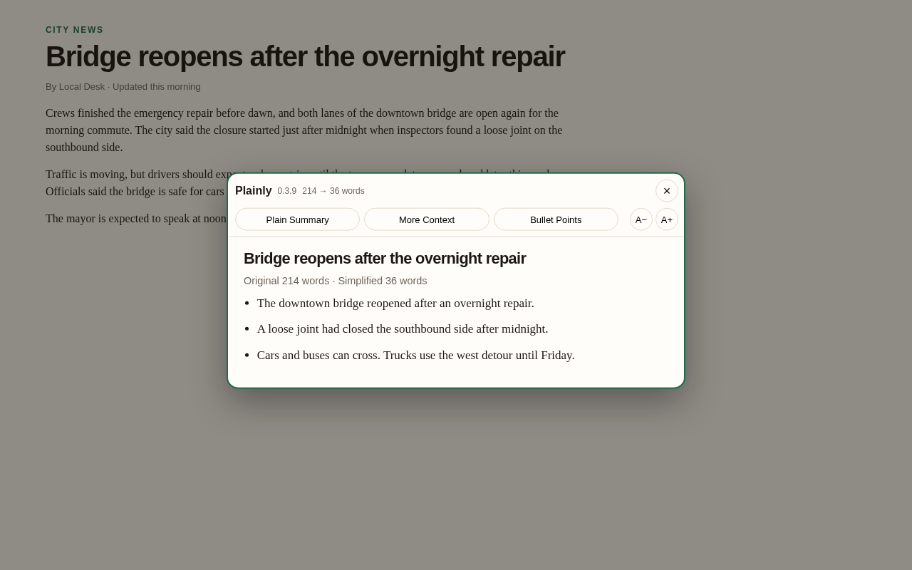
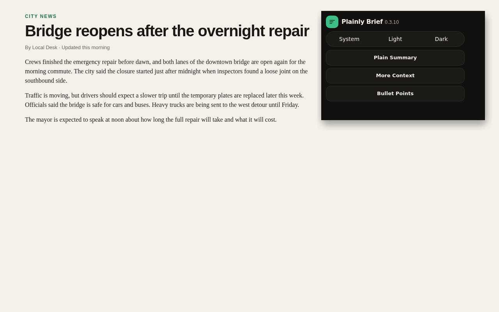
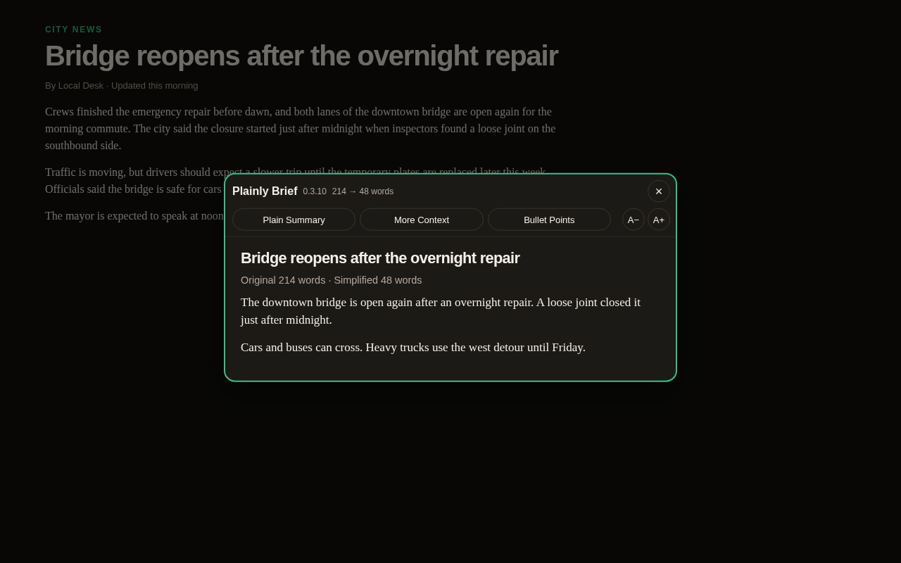

# Plainly Brief

A Firefox extension that turns a news article into a shorter, plainer summary on your device. Nothing is uploaded.

  

  <a href="https://addons.mozilla.org/en-US/firefox/addon/plainly-brief/"><strong>Get it for Firefox</strong></a>

  <a href="https://github.com/stumpyteam/plainly-brief/releases/download/v0.3.13/Plainly-Brief-0.3.13.xpi"><strong>Download Plainly Brief 0.3.13</strong></a>

## Release notes

**0.3.13**

Summaries run on your device. Nothing in the summary is uploaded.

More Context and Bullet Points are a one-time $4.99 unlock. Buy unlock opens checkout. After payment, paste the code from your receipt email and press Unlock. The unlock stays on that browser.

## Screenshots

  
   
  A plain summary opens over the article. Close it to see the original.

  
   
  Bullet Points turns the same story into a short list.

  
   
  Pick a summary style from the toolbar button.

  
   
  The same summary in dark mode.

## Install

- Firefox: install from [Mozilla Add-ons](https://addons.mozilla.org/en-US/firefox/addon/plainly-brief/)

## Load it manually (temporary)

The `.xpi` is unsigned, so Firefox will only keep it until you quit.

1. Open `about:debugging#/runtime/this-firefox`
2. Click **Load Temporary Add-on…**
3. Choose [Plainly-Brief-0.3.13.xpi](https://github.com/stumpyteam/plainly-brief/releases/download/v0.3.13/Plainly-Brief-0.3.13.xpi), or choose `extension/manifest.json`
4. Open an article and click the Plainly toolbar button

## What it does

- **Plain Summary** is free. **More Context** and **Bullet Points** are a one-time $4.99 unlock
- The panel shows the original word count next to the simplified one
- **A−** and **A+** change the reading size and remember it
- System, light, and dark follow the popup. Click the version number four times to unlock Dracula
- The reader keeps article paragraphs and drops video cards, share buttons, and newsletter prompts

## Layout

- `extension/` is the add-on (Manifest V3)
- `src/simplify.ts` is the summarizer. `extension/simplify.js` is the copy the add-on loads
- `Plainly-Brief-0.3.13.xpi` is the packed add-on for temporary install

Firefox's own pages (`about:`, settings, addons.mozilla.org) cannot be rewritten. Open a normal article instead.

## Mozilla listing

`mozilla-listing/` has the icon, screenshots, summary, and description for the add-on page.
The manifest declares `data_collection_permissions.required` as `none`, because nothing is sent off the device.

## Unlock

Plain Summary is free. More Context and Bullet Points are a one-time $4.99 unlock. The add-on checks the code on the device.
